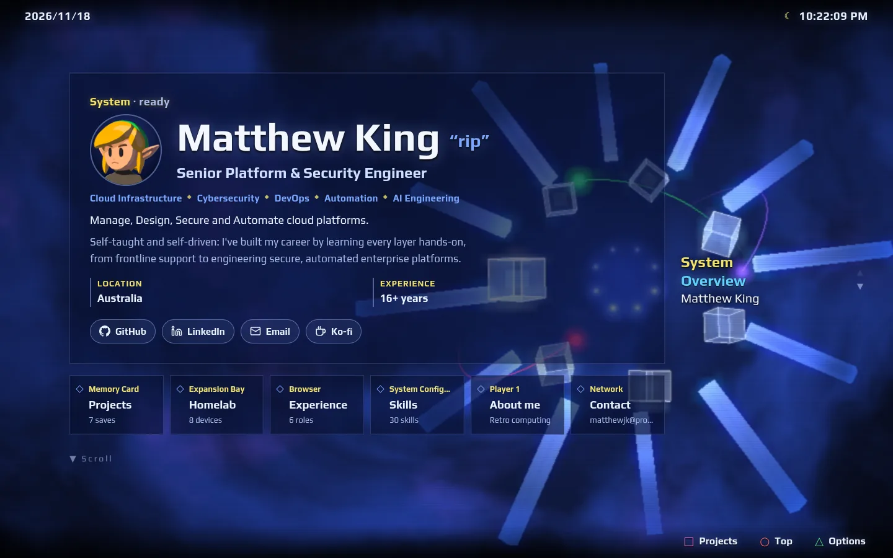
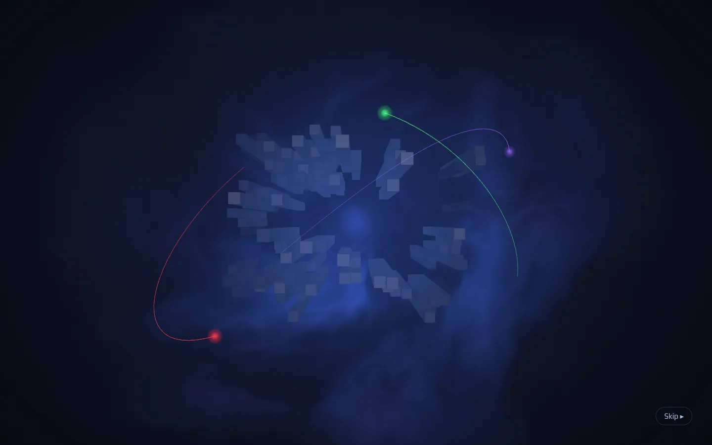
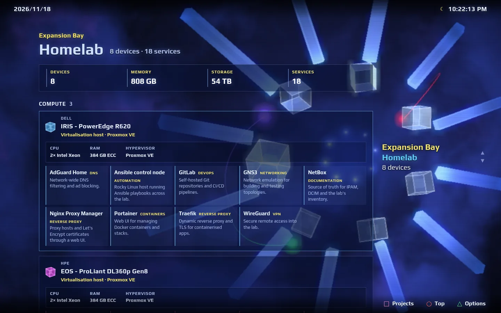
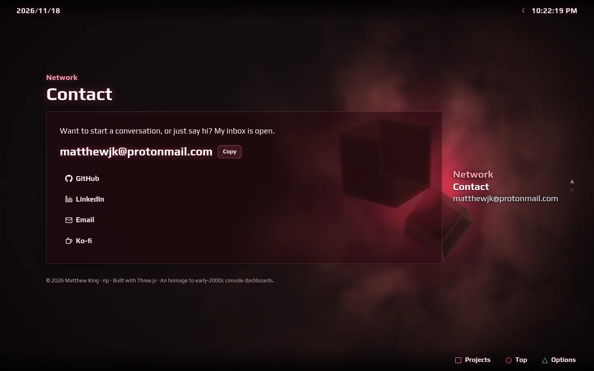

<div align="center">

# portfolio-website

**A full-screen WebGL portfolio inspired by early-2000s console dashboards.**
Boot sequence, crystal menu, CRT-style output: no framework, just TypeScript, Three.js and shaders.

[](https://www.typescriptlang.org/)
[](https://threejs.org/)
[](https://vitejs.dev/)
[](https://www.khronos.org/webgl/)
[](https://www.khronos.org/opengl/wiki/Core_Language_(GLSL))

[](https://developer.mozilla.org/docs/Web/HTML)
[](https://developer.mozilla.org/docs/Web/CSS)
[](https://nodejs.org/)
[](https://github.com/features/actions)
[](https://pages.github.com/)
[](#how-it-works)

[](https://ripcrispy.github.io/portfolio-website/)

**[▶ View the live site](https://ripcrispy.github.io/portfolio-website/)**

</div>

| Boot sequence | Homelab | Contact |
| :---: | :---: | :---: |
|  |  |  |

## Features

- **Boot sequence:** a field of towers flies out of the dark, orbiting light trails, your name. Skippable with any key, click or tap, and shortened on repeat visits.
- **Live 3D dashboard:** a full-screen scene with a rotating crystal ring, glass spokes and a swirling nebula. Scrolling glides the camera between sections; click a crystal to jump straight there.
- **Contact "insert disc" screen:** the whole scene turns to dark red smoke and smoked-glass cubes on the final section.
- **Real data, baked at build time:** GitHub repos, the contribution graph and your avatar are fetched during the build, so visitors never hit GitHub's rate limits.
- **Readable everywhere:** all content is real HTML pre-rendered into `index.html`. It works without JavaScript or WebGL and is indexable by search engines.

## How it works

| Piece | What it does |
| --- | --- |
| **Vite plugin** (`vite.config.ts`) | Renders `src/content.json` into the HTML and bakes in GitHub repos, activity and avatar (cached on disk). |
| **Scene** (`src/scene/`) | Instanced towers (one draw call), crystal and glass-spoke shaders, a low-res nebula pass, a camera path driven by scroll. |
| **Output pipeline** (`src/scene/output.ts`) | *Composite* mode renders at ~576 lines with chroma bleed, scanlines and dithering; *Component* mode is sharp. Both share a cheap glow pass. |
| **Overlay** (`src/overlay/`) | HTML renderers, HUD clock, section label, scroll engine with section gliding. |

**Performance:** rendering uses a fixed pixel budget (a 4K screen costs about the same as 1080p), the quality tier auto-adjusts if the frame rate drops, frames are capped at 60 fps, and rendering pauses in background tabs. Three.js loads in its own chunk after the text has painted. `prefers-reduced-motion` and no-WebGL fallbacks are built in.

## Editing content

Everything lives in **`src/content.json`**: profile, links, stats, projects, homelab, experience, skills (with optional `level` 0–100), the About section and the GitHub username. In dev, saving it reloads the page.

**Homelab** devices take a `name`, `vendor`, `role`, `kind` (`compute` / `storage` / `edge` / `network`), optional `status`, free-form `specs` and a list of `services`. Keep it public-safe: no IP addresses, internal hostnames or ports.

## Develop

```bash
npm install
npm run dev
```

Optional: put a GitHub token in `.env.local` (git-ignored) to avoid API rate limits while developing:

```bash
echo "GITHUB_TOKEN=your_token" > .env.local
```

URL flags: `?boot` replays the full intro · `?q=low|medium|high` forces a graphics tier · `?video=composite|component` picks the output style.

## Deploy (GitHub Pages)

1. Push to GitHub (any repo name works: the build uses relative paths, so it serves from `/<repo>/`).
2. **Settings → Pages → Source: GitHub Actions**.
3. Every push to `main` deploys via `.github/workflows/deploy.yml`, plus a daily rebuild to refresh the GitHub data.

---

<sub>An homage to early-2000s console dashboards. All visuals are original and rendered in real time; no console assets, logos or audio are used.</sub>
